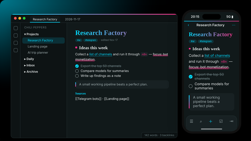

# 🌶 Chili — Obsidian theme

> ⭐ If Chili makes your vault nicer, a star helps other people find it. Found a bug or want a new pepper? [Open an issue](https://github.com/chi-li-peppers/obsidian-chili/issues), I read every one.

One theme, **27 pepper palettes**, each with a dark and a light mode. Built for both desktop (macOS) and mobile (iOS / Android).

## Features
- **Heat strip** — a thin accent gradient along the top of the window
- Gradient H1 + inline title, serif headings (Iowan Old Style / Charter / Georgia), dotted H2 markers
- Pill tags, round checkboxes, highlighter-style `==marks==`, gradient-edged blockquotes
- **Mobile layout:** 17px text, looser line height, rounded bottom toolbar and drawers, bigger tap targets
- Palettes are contrast-checked: accent text ≥ 4.5:1 against the background in both modes

## Install
**Manual:** copy `theme.css` and `manifest.json` to `<vault>/.obsidian/themes/Chili/`, then *Settings → Appearance → Themes → Chili*.
On iPhone the vault folder syncs via iCloud, so the theme shows up there too.

## Pick a pepper
Install the [Style Settings](https://github.com/mgmeyers/obsidian-style-settings) plugin → *Settings → Style Settings → Chili → Pepper*.
Without the plugin, Jalapeño is used. Extra toggles: hide heat strip, flat headings, sans-serif headings.

Open `preview.html` in a browser to see all 27 variants on Mac and iPhone mockups.

## Palettes
| # | Pepper | Heat | Dark accents |
|---|---|---|---|
| 1 | Jalapeño | 🌶🌶 | `#3fa34d` / `#a7d16a` |
| 2 | Habanero | 🌶🌶🌶🌶 | `#ff7a1a` / `#ffc145` |
| 3 | Carolina Reaper | 🌶🌶🌶🌶🌶 | `#df4c5f` / `#ff6b6b` |
| 4 | Ghost | 🌶🌶🌶🌶🌶 | `#8e7cc3` / `#c9b8ff` |
| 5 | Poblano | 🌶 | `#3e9469` / `#7fb685` |
| 6 | Chipotle | 🌶🌶🌶 | `#c46437` / `#d98e4e` |
| 7 | Padrón | 🌶 | `#7a9a3a` / `#c5d86d` |
| 8 | Shishito | 🌶 | `#4db6ac` / `#9ed9c9` |
| 9 | Scotch Bonnet | 🌶🌶🌶🌶 | `#f2b705` / `#f27405` |
| 10 | Cayenne | 🌶🌶🌶🌶 | `#d6574a` / `#e67e22` |
| 11 | Espelette | 🌶🌶🌶 | `#e74d10` / `#f59f00` |
| 12 | Aleppo | 🌶🌶🌶 | `#d05466` / `#d17a22` |
| 13 | Urfa Biber | 🌶🌶🌶 | `#bc6184` / `#c08497` |
| 14 | Bird's Eye | 🌶🌶🌶🌶🌶 | `#ff3366` / `#ffb3c6` |
| 15 | Piri Piri | 🌶🌶🌶🌶 | `#ff6f59` / `#43aa8b` |
| 16 | Banana | 🌶 | `#e9c46a` / `#2a9d8f` |
| 17 | Fresno | 🌶🌶🌶 | `#e7404c` / `#4f8fc0` |
| 18 | Pasilla | 🌶🌶 | `#8e789b` / `#b48ead` |
| 19 | Guajillo | 🌶🌶 | `#c66650` / `#e9a178` |
| 20 | Ancho | 🌶🌶 | `#c0674a` / `#c08552` |
| 21 | Serrano | 🌶🌶🌶 | `#10b981` / `#f97316` |
| 22 | Datil | 🌶🌶🌶🌶 | `#f59e0b` / `#84cc16` |
| 23 | Purple Bell | 🌶 | `#9864f1` / `#f472b6` |
| 24 | Ají Amarillo | 🌶🌶🌶 | `#ffb000` / `#ff5f1f` |
| 25 | Pepper X | 🌶🌶🌶🌶🌶 | `#00d9ff` / `#ff2e88` |
| 26 | Adjika | 🌶🌶🌶🌶 | `#ed3a48` / `#6a994e` |
| 27 | Svan Salt | 🌶🌶 | `#e07a5f` / `#81b29a` |

## Build
`theme.css` is generated: palettes are derived from two accent colors per pepper (backgrounds tinted by the accent hue, accents auto-adjusted for contrast).

## License
MIT

⭐ Like it? [Star the repo](https://github.com/chi-li-peppers/obsidian-chili) · Ideas and bugs: [issues](https://github.com/chi-li-peppers/obsidian-chili/issues)
